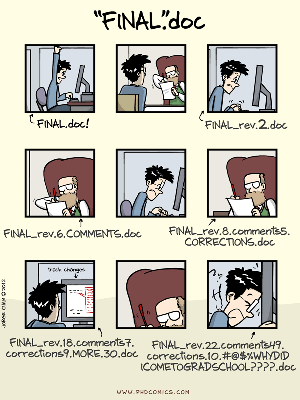
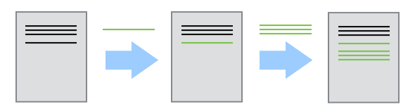
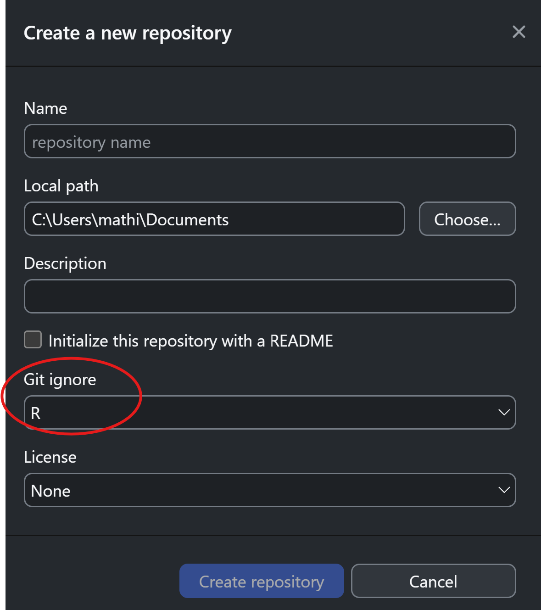
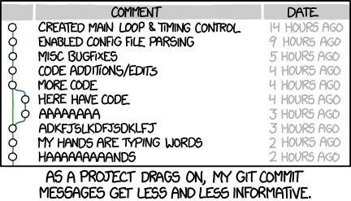
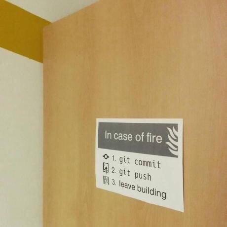
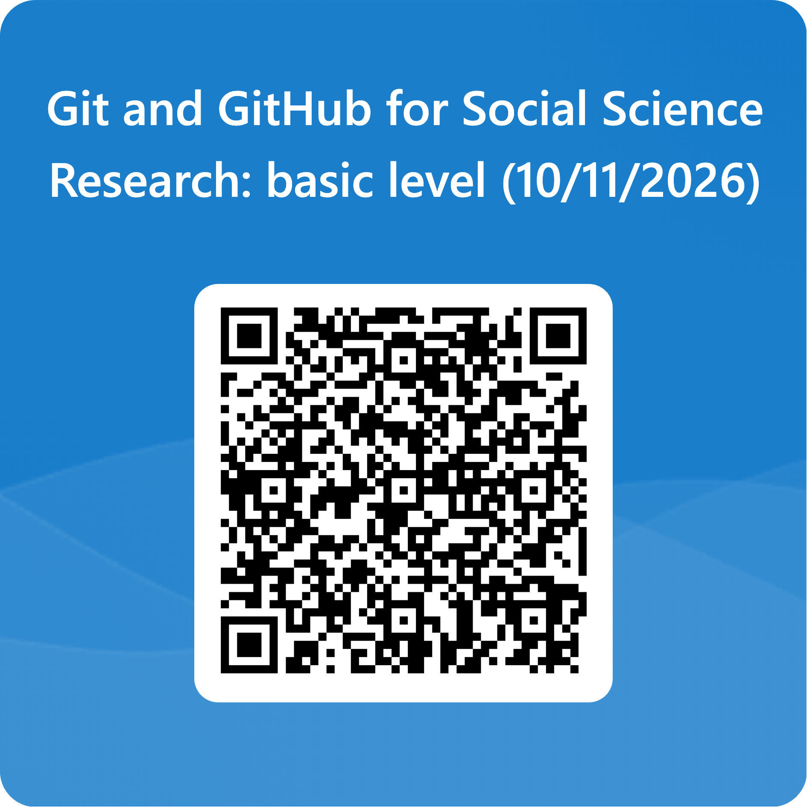
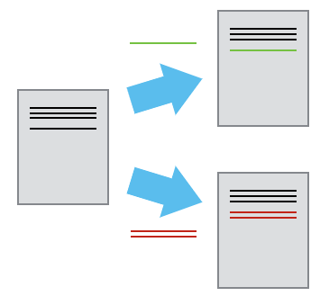
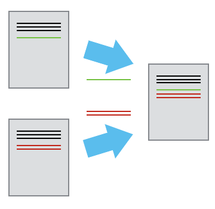

# Before we start {style="text-align: center;" .center}

## Any knowledge yet?

* How many of you are already familiar with Git/GitHub and/or other so called "version control" systems?
* How many of you have already installed GitHub Desktop on your computer?

## Agenda for today

* Introduction
* Setting up the environment
* Your first (or maybe not?) repository
* The git (and GitHub) workflow to track changes

::: {.callout-note appearance="minimal"}
Some of the vocabulary we will be using today are specific to git/GitHub: don't be hesitate to ask if something is unclear!
:::

# Introduction {style="text-align: center;" .center}

## Learning objetives

* Understand the basics of automated version control
* Understand the basics of `git` and `GitHub`
* Use GitHub Desktop to control the different version of a mock project
* Be introduced on how to apply version control to your research

## A problem we all know

:::: {.columns}
::: {.column width="50%"}

[](https://phdcomics.com/comics/archive.php?comicid=1531){data-preview-link="true"}

PhD Comics "[FINAL.doc](https://phdcomics.com/comics/archive.php?comicid=1531){data-preview-link="true"}"

:::
::: {.column width="50%"}

#### Or from a code perspective...

```
my_analysis.R
my_analysis_FINAL.R
my_analysis_FINAL_v2.R
my_analysis_FINAL_v2_REVIEWED.R
my_analysis_FINAL_v2_REVIEWED_Jan.R
my_analysis_THIS_ONE.R
```

:::
:::

## A solution: version control

* We can record who made which changes, and when
* We can revert to previous versions
* We can identify and correct conflicts (e.g. possible overwriting)
* Nothing that is *committed* is *ever* lost (unless you try hard…)

**Version control is like an unlimited ‘undo/redo’.**

## How version control works {.smaller}

Version control is like a 'recording' of history



...Rewind and play changes back again!

## Why should researchers care? {.smaller}

<br />

| Challenge | Git Solution |
|-----------|-------------|
| "This chapter went sideways" | You can always track back when it deviated |
| "Which script produced this table?" | Every output is linked to exact code |
| "My collaborator broke something" | Revert to a working state instantly |
| "Reviewers want my analysis code" | Share a clean, documented history |
| "I deleted a crucial file" | Nothing is ever truly gone |


<br/>

::: {.callout-tip}
Git is a core infrastructure for [**reproducible research**](https://book.the-turing-way.org/){data-preview-link="true"}
:::


## You may also wonder...

What about: 

- `Microsoft Office 365`? 
- `Google Drive`? 
- `Dropbox`? 
- (etc. etc.)

**They do provide a "history of changes", so what?**


# Version control with Git and GitHub {style="text-align: center;" .center}

## What is Git?

Git is a **version control system** — a tool that tracks changes to files over time.

- Takes "snapshots" of your project at key moments
- Lets you travel back to any previous state
- Records *who* changed *what* and *why*
- Enables safe collaboration with others

::: {.callout-note appearance="minimal"}
Originally built for software — now essential for research.
:::

## What is GitHub? {.smaller}

GitHub is a cloud-based platform that allows people to store, manage, and collaborate on research projects using `Git`

Core features:

- **Git Hosting and backup**: It hosts Git repositories (projects), which allows you to be safe and work from multiple computers.
- **Collaboration**: Multiple researchers can work on the same project simultaneously, creating "branches" to test new features without breaking the main, stable work.
- **Social Coding**: Users can share their projects openly, follow others, and contribute to building reproducibility and trust in research.

::: {.callout-tip}
Read more about GitHub in [GitHub doc](https://docs.github.com/en){target="_blank"}
:::


## Git vs. GitHub

| | Git | GitHub |
|---|---|---|
| **What** | Local software | Cloud service |
| **Does** | Tracks changes locally | Hosts repos online |
| **Analogy** | Your wallet | Your bank |

<br/>

::: {.callout-note appearance="minimal"}
Other platforms: [GitLab](https://about.gitlab.com/){target="_blank"}, [Bitbucket](https://bitbucket.org/){target="_blank"} — same Git, different banks.
:::

# Tutorials

## 3 separate blocks

- Block 1: create your first repository
- Block 2: modify files and see changes
- Block 3: clone and fetch (or simpler: synchronize your computer with the latest online version of your work)

# Tutorial Block 1: create your first repository {style="text-align: center;" .center}

## Summary Block 1

- The projects are called "repository" or "repo"
- Publishing a repository does not mean you make it public: it just means that you add it to your online GitHub
- The projects lives online and offline, on your computer (in a folder)
- You can make a project "public" once it is ready to be shown and used by everyone

## Setup your future projects to ignore some of your files
[]

Choose your programming language directly when creating a new project

# Tutorial Block 2: modify files and see changes {style="text-align: center;" .center}

## The commit: heart of Git {.smaller}

A **commit** is a permanent snapshot of your project with:

- A unique ID (hash): `a3f92bc`
- Author name and email
- Timestamp
- A message you write
- The exact state of every tracked file

::: {.callout-tip}
Commits are your research diary — make them meaningful.

The complete history of **commits** and metadata is a **repository**
:::

## Good commit messages? {.nostretch}
What is likely to happen…

{width="50%"}

```
✅ "Recode income variable to quintiles for Table 3"
❌ "fixed stuff"
❌ "asdfgh"
```


## Understanding Commit History {.smaller}
Your project's history is a sequence of commits, each identified by a unique hash — a long alphanumeric string like `a3f92bc`. 

Each commit records:

- Which files changed and exactly what changed in each file
- Who made the commit (name and email)
- When it was committed
- The commit message describing the change
- A pointer to the previous commit (parent)

::: {.callout-tip}
This **chain of commits** is what makes Git a reliable audit trail — equivalent to a laboratory notebook for your research.
:::

# Tutorial Block 3: clone and fetch {style="text-align: center;" .center}

## Summary Block 3

- Because your project also lives online, it is not a problem if you delete it on your computer
- You can work on the same project from different computer, and with different persons (next session!)
- If you work from different computers, think about what is the most up-to-date version of your work and fetch origin

# Wrap up and takeaways {style="text-align: center;" .center}

## Key Takeaways {.smaller}


1. **Commit often** — small, meaningful snapshots
2. **Write good messages** — future you will thank you
3. **Push to GitHub** — backup, collaboration, transparency


::: {.callout-tip}
**Git gives your research a memory.**
:::

## Seriously, `git push` when done…

{.r-stretch}


## Advantages...

- **Intentional history** — every saved version has a message explaining why it changed, not just when
- **Works on anything** — code, data, config files, and integrates with automation tools far beyond what a document editor supports
- **Real collaboration** — branching and merging let multiple people work in parallel without overwriting each other

## ...and disadvantages {.smaller}

- **Steep learning curve** — Git concepts come from software development and don't map intuitively onto research workflows
- **Non-optimal fit for common file formats** — Word, Excel, and SPSS/Stata files can't be meaningfully "diffed"
- **Data privacy risks** — Sensitive survey or interview data can be accidentally exposed
- **Collaboration culture mismatch** — Academics are used to email and track-changes
- **Weak institutional incentives** — Few disciplines reward reproducible, version-controlled research

## Git, reproducibility and Open Science

Git + GitHub enables powerful open science practices:

- **Persistent links** to exact code used in a paper
- **Tags and releases** to mark submission versions
- **GitHub/Zenodo integration** — auto-DOI for every release
- **GitHub Issue tracker** — structured feedback from reviewers or collaborators

::: {.callout-tip}
A public GitHub repository is increasingly expected at submission.
:::


## Your feedback matters! 

{fig-align="center"}

Link: [https://forms.cloud.microsoft/e/ng0i1fhJxp](https://forms.cloud.microsoft/e/ng0i1fhJxp)

## Three more tutorials

- Working with senstiive data: how to avoid tracking every file
- Working with VS code
- Working with R Studio

## Any question? {style="text-align: center;" .center background-image="/images/just_science_done_right.png" background-position="top right" background-repeat="no-repeat" background-size="15%" .smaller}

::: {style="text-align: center; margin-top: 1em"}
Simone Sacchi

Research Data Librarian, EUI Library

[simone.sacchi@eui.eu](mailto:simone.sacchi@eui.eu) | [resdata@eui.eu](mailto:resdata@eui.eu)

[**EUI Library Research Data Guide**](https://eui.libguides.com/research-data-guide){data-preview-link="true"} - [**EUI Library Trainings**](https://www.eui.eu/events?u=lib){data-preview-link="true"}

{fig-align="center" width="60%"}
:::

## Essential resources
[*Happy Git and GitHub for the useR*](https://happygitwithr.com/) by Jenny Bryan — free online, written for researchers.


## End of the presentation {style="text-align: center;" .center}

## BACKUP SLIDES {style="text-align: center;" .center}

## Your First Git Commands

Configure `git` from the command-line, here's how:

```bash
# Set up once on your machine
git config --global user.name "Ada Lovelace"
git config --global user.email "ada@research.ac"

# Start tracking a project
git init

# See what has changed
git status

# Stage a file
git add analysis.R

# Save a snapshot with a message
git commit -m "Add baseline regression model"
```

## Multiple contributors (branching)

* Two people work on a document
  * Each makes independent changes: two versions



* Changes are separate from the document


## Combining changes (merging)

* Several changes can be merged onto the same base document
  * 'Merging'

